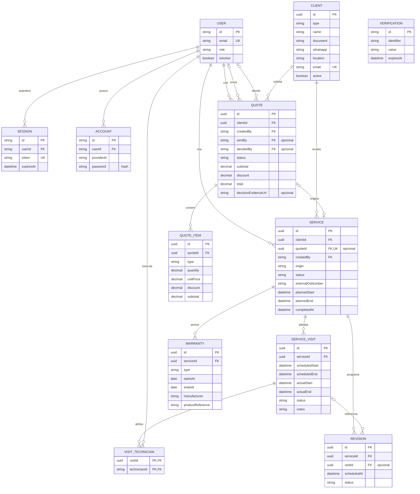
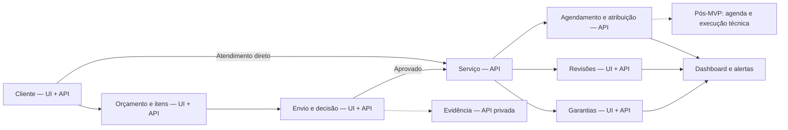

# Modelagem de dados — TechPro

**Entrega final: 25/11/2026.** Modelo lógico-relacional da implementação, derivado do [schema Prisma](../api/prisma/schema.prisma) e das [migrations versionadas](../api/prisma/migrations/README.md). O diagrama original de levantamento permanece no PRD como registro da concepção. Este DER representa as tabelas efetivamente modeladas, não a disponibilidade de todas as operações na interface.

## Diagrama entidade-relacionamento

O DER mostra campos selecionados, chaves e cardinalidades; o schema Prisma contém todos os campos, tipos, valores padrão, índices e mapeamentos físicos. `VERIFICATION` é uma tabela independente do Better Auth, sem chave estrangeira para usuário.

## Dicionário de entidades

| Modelo Prisma | Tabela PostgreSQL | Responsabilidade e estado |
| --- | --- | --- |
| User | user | Identidade, perfil ADMIN/PLANNING/TECHNICIAN e atividade; administração pela API/UI. |
| Account | account | Credenciais e contas do Better Auth; senha persistida como hash. |
| Session | session | Sessões com token único e expiração; revogação no fluxo de autenticação. |
| Verification | verification | Estrutura de verificação da biblioteca; recuperação de senha não entregue. |
| Client | client | Identificação PF/PJ, contatos e localização; CRUD e inativação pela API/UI. |
| Quote | quote | Orçamento, valores, status, autoria, datas de envio/decisão e referência de evidência; CRUD e decisão integrados. |
| QuoteItem | quote_item | Itens e valores decimais do orçamento. |
| Service | service | Atendimento direto ou derivado de orçamento aprovado; referência manual à OS; API integrada, UI futura. |
| ServiceVisit | service_visit | Agendamento, período previsto e observações; API integrada. Campos reais de execução existem, mas não são editáveis pela API atual. |
| VisitTechnician | visit_technician | Relação N:N entre visitas e técnicos; chave primária composta; atribuição por API. |
| Warranty | warranty | Garantia de serviço/fabricante, início e término; API e UI integradas. |
| Revision | revision | Revisão programada, situação e vínculo opcional com visita; API e UI integradas. |

## Integridade e decisões de modelagem

- Cada orçamento pertence a um cliente e pode originar no máximo um serviço (`Service.quoteId` opcional e único). Serviços diretos não precisam de orçamento. A API valida aprovação e vínculo com o cliente.
- Um serviço pode existir sem visitas; visitas, garantias e revisões pertencem a um serviço. Cada revisão pode referenciar opcionalmente uma visita do mesmo serviço, validado pela API.
- Uma visita admite zero ou mais técnicos; a associação usa chave composta e a API aceita somente técnicos ativos. A localização vem de `Client.location`, não de uma coluna própria da visita. A confirmação explícita de conflitos e os bloqueios transacionais estão no [contrato de visitas](visit-api.md).
- Orçamentos e itens usam `Decimal` para valores e quantidades; valores monetários não usam ponto flutuante para cálculo no servidor. O envio e a decisão registram autores opcionais para preservar compatibilidade com registros anteriores.
- Garantias utilizam datas sem horário (`@db.Date`); agendamentos e registros de negócio utilizam timestamps. Os alertas são calculados a partir das datas e estados, sem tabela de notificações.
- Evidências de orçamento são objetos privados no armazenamento S3/RustFS; o banco mantém `decisionEvidenceUrl`. Não existe uma tabela de arquivos ou integração com estoque/OS.
- A exclusão de orçamento em rascunho tem cascata sobre itens. A remoção de um serviço ou visita possui regras referenciais definidas no schema; não há endpoint de exclusão de serviço/visita na entrega. O vínculo opcional de revisão com visita usa `SetNull`.
- Status de orçamento, revisão e tipos são enums no banco; status de serviço e visita são strings validadas na camada de aplicação. Campos de início/fim real de visita e transições futuras estão modelados, mas a API atual cria visitas como SCHEDULED e não registra execução.

## Fluxo disponível e limites

O fluxo descreve a integração dos módulos, não uma demonstração integral pelo navegador. A criação de serviço e o planejamento de visitas ainda exigem chamadas à API. Consulte a [matriz de entrega](entrega-final.md), o [PRD](documento-requisitos.md) e os contratos técnicos para os limites exatos.
